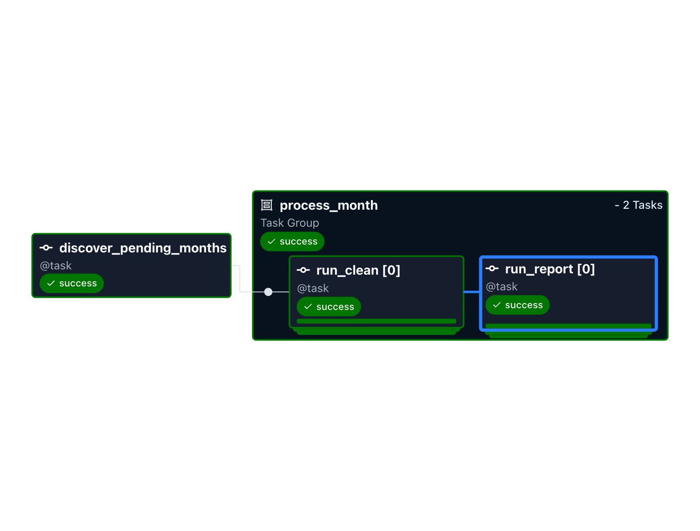
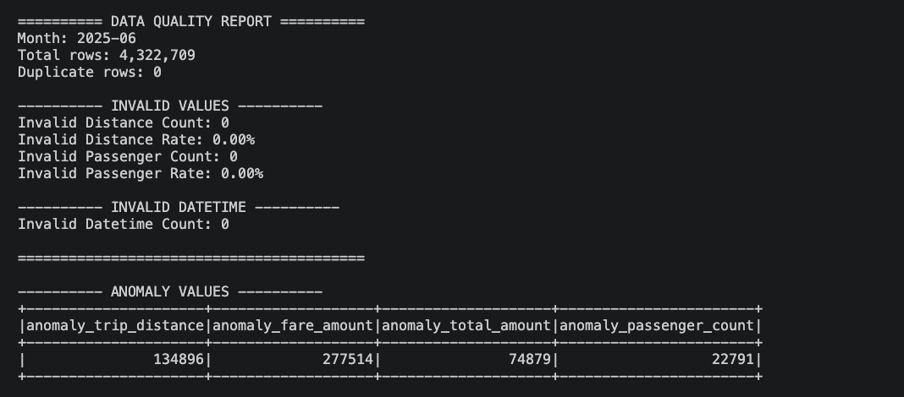

# NYC Taxi Data Quality Pipeline

An end-to-end data quality pipeline built with **Python, PySpark, and Apache Airflow** to process monthly NYC Yellow Taxi trip data.

## 1. Project Overview

This project demonstrates how to build a local data engineering pipeline that:

- Processes monthly NYC Yellow Taxi Parquet datasets.
- Cleans and validates taxi trip records using PySpark.
- Stores processed data in a Silver layer.
- Generates data quality reports.
- Detects unprocessed months and avoids unnecessary reprocessing.
- Orchestrates cleaning and reporting tasks with Apache Airflow.

The project uses NYC Yellow Taxi trip data from January to December 2025.


## 2. Tech Stack

| Technology | Purpose |
|------------|---------|
| Python | Pipeline development |
| PySpark | Large-scale data processing |
| Apache Airflow | Workflow orchestration |
| Apache Parquet | Raw and Silver data storage |
| Git | Version control |

## 3. Pipeline Architecture

```text
NYC Yellow Taxi Parquet Files
             |
             v
        Raw Layer
             |
             v
   Discover Pending Months
             |
             v
    Apache Airflow DAG
             |
             v
      PySpark Cleaning
             |
             v
       Silver Layer
             |
             v
    Silver Validation
             |
             v
    Data Quality Report
```

Airflow uses Dynamic Task Mapping to create processing tasks for pending months.

Each month follows the dependency:

`run_clean → run_report`

The reporting task runs only after the cleaning task succeeds.

## 4. Data Cleaning

The cleaning pipeline performs the following operations:

- Filters records by the selected pickup month.
- Removes records with invalid pickup and dropoff timestamps.
- Identifies negative fare and total amount values.
- Creates anomaly flags for suspicious trip records.
- Writes processed data to monthly Silver Parquet directories.
- Validates existing Silver datasets before skipping reprocessing.

## 5. Data Quality Checks

The pipeline reports:

- Total row count.
- Duplicate row count.
- NULL count and NULL percentage by column.
- Invalid trip distances.
- Invalid passenger counts.
- Invalid pickup and dropoff timestamps.
- Records outside the processing month.
- Anomalous fare, distance, and passenger values.

Not all anomalous records are automatically deleted. Some are retained and flagged for further analysis.

## 6. Incremental Processing

The pipeline scans available Raw files and checks whether a corresponding Silver dataset exists with a `_SUCCESS` marker.

Months without a completed Silver output are added to the pending list.

This allows the pipeline to avoid unnecessary reprocessing of completed months.

## 7. Error Handling

The cleaning script uses exit codes to communicate processing results to Airflow.

| Exit Code | Meaning | Airflow Behavior |
|---|---|---|
| 0 | Success | Continue |
| 1 | Retryable error | Retry according to task settings |
| 2 | Invalid pipeline data | Fail without retry |
| 3 | Missing Raw file | Fail without retry |

## 8. Project Structure

```text
project/
├── dags/
│   └── taxi_trip_pipeline.py
├── src/
│   ├── clean.py
│   ├── discover.py
│   └── explore.py
├── test/
│   ├── __init__.py
│   └── t.py
├── raw/                # Local data, not tracked by Git
├── silver/             # Generated data, not tracked by Git
├── staging/            # Local intermediate data
├── .gitignore
├── requirements.txt
└── README.md
```

## 9. Running the Pipeline

### Step 1: Create a Virtual Environment

```bash
python3 -m venv .venv
source .venv/bin/activate
```

### Step 2: Install Dependencies

```bash
python -m pip install -r requirements.txt
```

### Step 3: Create Data Directories

```bash
mkdir -p raw silver staging
```

Place the NYC Yellow Taxi Parquet files in the `raw/` directory.

Run data cleaning for a selected month:

```bash
python src/clean.py --month 2025-06
```

Generate a data quality report:

```bash
python src/explore.py --month 2025-06
```

Discover months requiring processing:

```bash
python src/discover.py
```
### Running with Apache Airflow

Configure Airflow to discover the project DAGs:

```bash
export AIRFLOW__CORE__DAGS_FOLDER="$(pwd)/dags"
```

Start Airflow locally:

```bash
airflow standalone
```

Open the Airflow web interface:

```text
http://localhost:8080
```

Find the DAG named `nyc_taxi_pipeline` and trigger it manually.

The pipeline automatically discovers pending months and dynamically creates cleaning and reporting tasks.

If all available months have valid Silver outputs, no new monthly processing tasks will be created.

**Note:** This project is designed for local execution. The Airflow process must use a Python environment with the project dependencies installed.

The Airflow DAG is defined in `dags/taxi_trip_pipeline.py` with DAG ID `nyc_taxi_pipeline`.

Airflow must be configured to load the project's DAG directory before running the workflow.


## 10. Sample Data Quality Results

Example results for June 2025:

| Metric | Result |
|---|---:|
| Total Silver Rows | 4,322,709 |
| Duplicate Rows | 0 |
| Invalid Trip Distance | 0 |
| Invalid Passenger Count | 0 |
| Invalid Datetime | 0 |
| NULL Passenger Count | 1,212,716 |
| NULL Passenger Rate | 28.05% |

These results illustrate the difference between invalid numeric values and missing values.

## 11. Future Improvements

- Export data quality reports to structured CSV or JSON files.
- Add automated unit and integration tests.
- Improve Spark aggregation performance.
- Add data quality thresholds and alerting.
- Add pipeline monitoring and execution metrics.

## 12. Data Source

NYC Taxi & Limousine Commission (TLC) Trip Record Data:

https://www.nyc.gov/site/tlc/about/tlc-trip-record-data.page

Raw datasets are excluded from the Git repository.

## 13. Pipeline Screenshots

### Airflow DAG Execution



### Data Quality Report — June 2025

